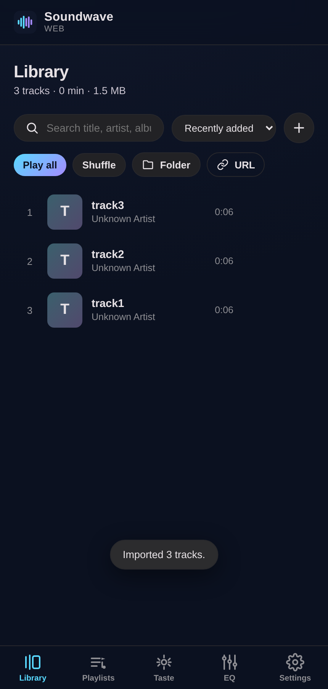
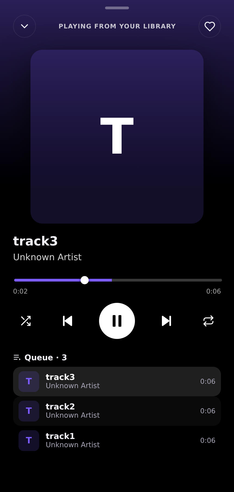
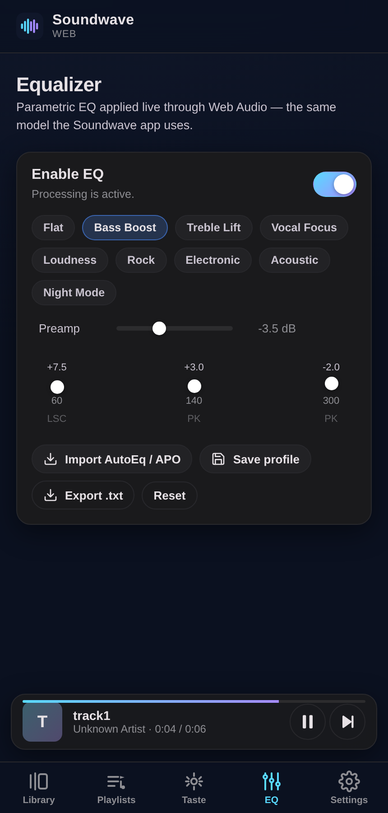
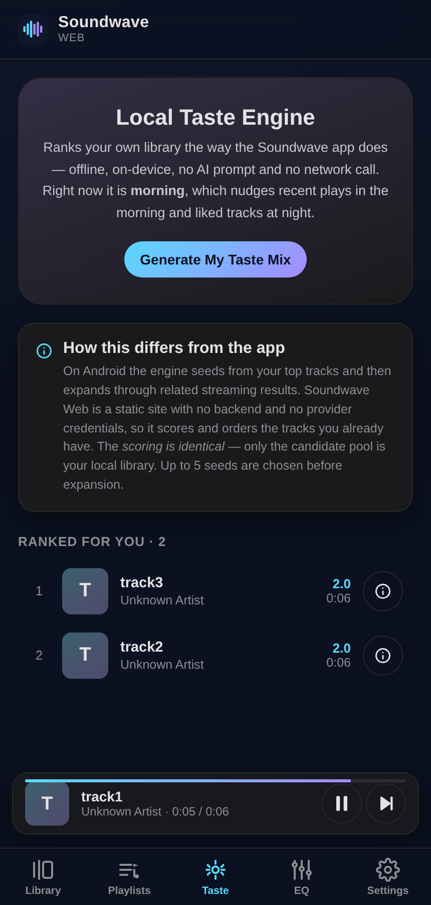
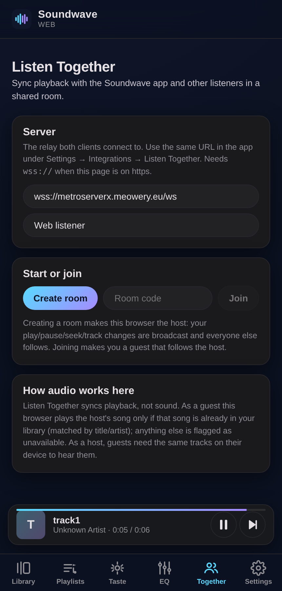

# Soundwave Web

A browser build of the [Soundwave](https://github.com/Anshug36c/sound-wave) music player, deployed
as a static site on **GitHub Pages**. It shares Soundwave's design language and ports several of its
engine algorithms, and it is **local-first**: your music and listening history never leave your
device.

**Live site:** https://anshug36c.github.io/soundwave-site/

> [!IMPORTANT]
> This is **not** the Android app and cannot be. A browser page cannot run Jetpack Compose, Kotlin,
> native C++ audio, or a Room database, and GitHub Pages serves only static files. Soundwave Web is
> an independent TypeScript/React player that plays **audio files you give it** — local files or a
> direct audio URL. It does **not** stream from YouTube/Spotify, has **no cloud AI**, and needs no
> account. See [NOTICE.md](NOTICE.md) for the exact scope and the code ported from the GPL-3.0 app.

## Features

- **Library** — import files or a whole folder, parse ID3/Vorbis/MP4/FLAC tags and cover art,
  search, sort, like, and remove. On Chromium browsers, folder access can be re-granted so the
  library survives reloads.
- **Playback** — play/pause, seek, next/previous, shuffle, repeat (off/all/one), volume, and OS
  lock-screen controls via the Media Session API.
- **Crossfade** — dual-deck Web Audio crossfade with the app's adaptive pre-arm behaviour.
- **Playback cutoff guard** — the v1.4.3 hardening that distinguishes a genuine end-of-track from a
  stream that died early, and recovers within a retry budget.
- **Parametric equalizer** — the same `ParametricEQ` biquad model as the app, with presets, a
  preamp, per-band gain, and **EqualizerAPO / AutoEq** profile import (paste one of the 8850 AutoEq
  headphone profiles and it applies live).
- **Local Taste Engine** — offline scoring of your own listening history (play time, skips, likes,
  recency, time of day) that builds a "My Taste Mix", with a per-track breakdown of *why* each track
  ranked where it did.
- **Listen Together** — synced group listening with the **Soundwave Android app** (and other web
  sessions). The web build speaks the app's own relay protocol (binary protobuf `Envelope` frames
  over WebSocket, ported from `listentogether.proto`): create or join a room, and play/pause/seek/
  track/queue/volume stay in lockstep across devices. See [Listen Together](#listen-together-1).
- **Playlists** — create, fill, play, and manage local playlists.
- **Visualiser** — live frequency bars or waveform over the artwork, from an `AnalyserNode`.
- **Themes** — dark (default), light, or system, using Soundwave's real palette.
- **Installable** — a web manifest and icons so it can be added to a home screen.

## Screenshots

Captured from the deployed site driving a real headless browser (`scripts/screenshot.mjs`).

| Library | Now playing | Equalizer | Local Taste Engine | Listen Together |
| --- | --- | --- | --- | --- |
|  |  |  |  |  |

## Listen Together

Synced listening with the Soundwave Android app. The app's Listen Together is a client/server
protocol: every participant opens a WebSocket to a relay and exchanges protobuf messages
(rooms, join approval, playback actions, resync). Soundwave Web implements the **same wire
protocol**, so a browser is a first-class participant — no modified APK required.

**Pairing with the phone:**

1. Pick a relay (below) and put the *same* URL in both places:
   - app: Settings → Integrations → Listen Together → server URL
   - web: Together tab → Server
2. One side **Create room**, the other **Join** with the room code. The host approves joins.
3. Press play on the host; everyone else follows in lockstep.

**Choosing a relay:**

| Option | Host a room? | Notes |
| --- | --- | --- |
| The public community server (default, `wss://…`) | **Join only** | It allowlists who may *host* (`host_not_allowed` for everyone else), but anyone can join a room the app hosts. Good for following a phone. |
| Your own relay (`server/`, this repo) | **Yes** | `cd server && npm install && npm start`, then point app + web at it (behind TLS for https pages). Either side can host; rooms are private to your server. |

**How audio works — please read.** Listen Together syncs *playback state*, not sound: each device
plays its own copy of the track. So as a **guest**, the browser can only play songs already in its
local library (matched by title/artist); anything else is shown as "not in your library" rather
than silently ignored, because a static page can't stream the phone's files or YouTube. As a
**host**, guests need the same tracks on their devices to hear them. This is a property of the
protocol and of static hosting, not a bug.

## Tech

React 18 · TypeScript · Zustand · Vite · Web Audio API · IndexedDB (`idb`) · `music-metadata`.
Tests: Vitest (unit) + Playwright (browser smoke). The optional relay (`server/`) is plain Node +
`ws`.

## Getting started

```bash
npm install
npm run dev          # http://localhost:5173
```

Build and preview the production bundle:

```bash
npm run build
npm run preview      # http://localhost:4173
```

## Verification

One command runs the whole gate: typecheck → unit tests → production build → browser smoke tests.

```bash
npm run verify
```

- `npm run typecheck` — `tsc --noEmit`, strict.
- `npm test` — **80 unit tests** over the ported algorithms. The Taste Engine, EQ parser, play-stats
  rules, cutoff guard, pre-arm manager, and the Listen Together protobuf codec are each checked
  against the exact behaviour of their Kotlin originals (constants, thresholds, and quirks
  included; the codec is cross-checked against bytes captured from a live relay).
- `npm run test:relay` — drives the `server/` relay with two simulated clients and asserts the
  server-side routing (rooms, join approval, playback broadcast, resync, guest-control rules).
- `npm run smoke` — builds, serves `dist/`, and drives a real headless Chromium:
  - `scripts/smoke.mjs` — mount → import → parse → play (AudioContext running, playhead advancing)
    → Taste → EQ → Settings → persistence across reload, failing on any console error.
  - `scripts/smoke-engine.mjs` — the three end-of-track behaviours a "does it play" check can't see:
    natural-end **auto-advance**, **single** history booking (no double-count), and crossfade
    **queue-index sync**.
  - `scripts/smoke-listen-together.mjs` — real **web ↔ app interop**: a simulated phone hosts a room
    and the browser joins as guest (resolving the host's track from its library, mirroring
    play/pause/seek, flagging unavailable tracks), then the browser hosts and the simulated phone
    follows. All over the live protobuf wire protocol via the relay.

The same `verify` gate runs in CI on every push and pull request (see
[`.github/workflows/ci.yml`](.github/workflows/ci.yml)).

> Browser smoke tests need Playwright's Chromium. Locally: `npx playwright install --with-deps
> chromium`. CI installs it automatically.

## Deployment

Pushing to `main` builds and publishes to GitHub Pages via
[`.github/workflows/pages.yml`](.github/workflows/pages.yml) (the official Pages deploy action).
`vite.config.ts` uses `base: './'` so all asset URLs are relative and the site works from its
`/<repo>/` project path.

**First-time setup:** in the repo, go to *Settings → Pages → Build and deployment → Source* and
select **GitHub Actions**.

## Project layout

```
src/
  audio/      Web Audio graph, engine (transport + crossfade), cutoff guard, pre-arm manager
  lib/        ported algorithms (taste, eq parser/presets, play-stats), Listen Together protobuf
              codec + WebSocket client, types, IndexedDB, tags
  state/      Zustand stores: main (UI ↔ engine ↔ storage) and listenTogether (room ↔ engine)
  ui/         shared primitives + inline SVG icon set
  components/ player bar, now-playing sheet, visualiser, toasts, import progress
  screens/    Library, Playlists, Taste, Equalizer, Together, Settings
server/       optional self-hostable Listen Together relay (Node + ws)
scripts/      fixture generator + Playwright smoke tests + relay self-test
```

## Privacy

No account, no analytics, no server, no network calls for playback. Library metadata, listening
history, playlists, EQ profiles, and settings live in your browser's IndexedDB. Audio bytes are not
uploaded — the page reads the files you select. Remote-URL tracks are fetched directly from their
own server (which must permit cross-origin requests).

## License

GPL-3.0 — see [LICENSE](LICENSE) and [NOTICE.md](NOTICE.md). Derives from Soundwave (GPL-3.0),
itself a source copy of Echo-Music (GPL-3.0).
