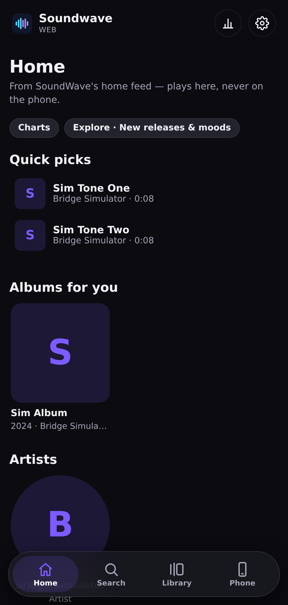
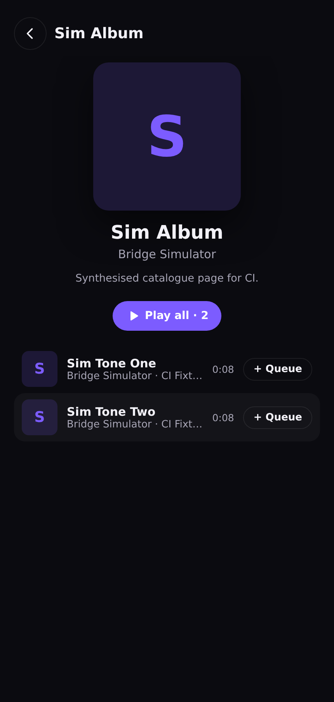

# Soundwave Web

A browser build of the [Soundwave](https://github.com/Anshug36c/sound-wave) music player, deployed
as a static site on **GitHub Pages**. It shares Soundwave's design language and ports several of its
engine algorithms, and it is **local-first**: your music and listening history never leave your
device.

**Live site:** https://anshug36c.github.io/soundwave-site/

> [!IMPORTANT]
> This is **not** the Android app and cannot be. A browser page cannot run Jetpack Compose, Kotlin,
> native C++ audio, or a Room database, and GitHub Pages serves only static files. Soundwave Web is
> an independent TypeScript/React player that plays **audio files you give it** — local files or a
> direct audio URL. It does **not** stream from YouTube/Spotify, has **no cloud AI**, and needs no
> account. See [NOTICE.md](NOTICE.md) for the exact scope and the code ported from the GPL-3.0 app.

## Features

- **Home** — the app's Home screen, whole: shelves from the YouTube Music home feed
  (quick picks, albums, artists, mixes) served by the connected SoundWave phone, plus
  **Charts** and **Explore** (new releases + mood/genre tiles) entries like the app's
  chips. No phone, no home feed — the screen offers to connect instead of showing
  placeholder data.
- **Search** — runs on the connected phone (YouTube Music, same catalogue as the app)
  with the app's type tabs: **Songs, Albums, Artists, Playlists**. Songs play here;
  albums/artists/playlists open their full pages (header, Play all, song list, related
  shelves) just like the app.
- **Stats & Settings** (top-right icons, like the app) — Stats counts listening done
  *in this browser*; Settings carries the app preferences that make sense here
  (theme incl. light, volume, a 5-band parametric EQ for the local player, data
  controls). The Library also has the app's Songs/Liked views.
- **Library** — import files or a whole folder, parse ID3/Vorbis/MP4/FLAC tags and cover
  art, like, and remove. On Chromium browsers, folder access can be re-granted so the
  library survives reloads. Files never leave the device.
- **Player** — the app's player, mirrored: a floating glass mini player above a floating
  glass bottom navigation (Home · Search · Library · Phone), and a full-screen player
  whose backdrop is the artwork itself, blurred and darkened into black, with seek,
  shuffle / previous / play / next / repeat, and the queue. It controls whichever player
  you last started — this browser's library or the phone-backed one; the two queues
  never mix.
- **Phone (Remote Web Player)** — the connection screen. The Soundwave Android app acts
  as a music *provider*: it searches and resolves tracks, this page plays them. Nothing
  plays on the phone. LAN (phone-served page) + free no-account tunnel for other
  networks. See [Phone](#phone--music-from-your-android-played-here).
- **Playback engine** — dual-deck Web Audio with the playback cutoff guard (distinguishes
  a genuine track end from a stream that died early) and OS lock-screen controls via the
  Media Session API.
- **Installable** — a web manifest and icons so it can be added to a home screen.

## Screenshots

Captured from the deployed site driving a real headless browser (`scripts/screenshot.mjs`).

| Home | Album page | Library | Full player |
| --- | --- | --- | --- |
|  |  |  |  |

## Phone — music from your Android, played here

The **Phone** tab turns the SoundWave Android app into a music provider for this page:

1. Android: SoundWave → Settings → **Remote Web Player** → enable (plus the free tunnel for off-network use). No account, no port forwarding — the phone dials out over SSH to localhost.run/serveo and shows a temporary HTTPS address.
2. Here: **Phone** tab → paste that address + the 6-digit pairing code → **Connect**. "Connected" is only shown after a health check *and* an authenticated session check pass.
3. **Home** shows your phone-powered recommendations and **Search** queries the phone's catalogue. Tap a track: it plays **here**, with this page's own queue, seek (byte-range), lock-screen controls and next/previous. The phone's own player, queue and notification are never touched — it can keep playing something else.

Same Wi-Fi? Even simpler: SoundWave also serves a small player page itself at its LAN address (shown with a QR code in the app) — open it in Safari. A secure page like this one cannot call the phone's `http://192.168…` address directly (browser mixed-content rules), which is why the phone serves that page; the tunnel path above also works on the same Wi-Fi, just via the internet.

Security in one breath: single-use 6-digit pairing codes (rate-limited), revocable 12-hour session tokens kept in `sessionStorage`, expiring stream grants, and the signed upstream audio URL never leaves the phone. Full details in the app's `REMOTE_WEB_PLAYER.md`.

## Tech

React 18 · TypeScript · Zustand · Vite · Web Audio API · IndexedDB (`idb`) · `music-metadata`.
Tests: Vitest (unit) + Playwright (browser smoke).

## Getting started

```bash
npm install
npm run dev          # http://localhost:5173
```

Build and preview the production bundle:

```bash
npm run build
npm run preview      # http://localhost:4173
```

## Verification

One command runs the whole gate: typecheck → unit tests → production build → browser smoke tests.

```bash
npm run verify
```

- `npm run typecheck` — `tsc --noEmit`, strict.
- `npm test` — **30 unit tests** over the audio engine guards and the remote bridge
  client (pairing, auth headers, error mapping), checked against the bridge protocol.
- `npm run smoke` — builds, serves `dist/`, and drives a real headless Chromium:
  - `scripts/smoke.mjs` — Home connect prompt → import → parse → play (AudioContext
    running, playhead advancing) → full player opens/closes → nav is exactly
    Home/Search/Library/Phone → persistence across reload, failing on any console error.
  - `scripts/smoke-engine.mjs` — the end-of-track behaviours a "does it play" check
    can't see: natural-end **auto-advance** (store index matches the engine's track)
    and **repeat-one** replay.
  - `scripts/smoke-bridge.mjs` — against a protocol simulator of the phone bridge:
    wrong pairing code rejected, Home shelves + typed Search served by the phone,
    album page opened from search and played, browser-side playback advancing,
    Range seek, pause/resume, queue/next, and the site's local player provably
    never started by any of it. Run standalone with `npm run smoke:bridge`.

The same `verify` gate runs in CI on every push and pull request (see
[`.github/workflows/ci.yml`](.github/workflows/ci.yml)).

> Browser smoke tests need Playwright's Chromium. Locally: `npx playwright install --with-deps
> chromium`. CI installs it automatically.

## Deployment

Pushing to `main` builds and publishes to GitHub Pages via
[`.github/workflows/pages.yml`](.github/workflows/pages.yml) (the official Pages deploy action).
`vite.config.ts` uses `base: './'` so all asset URLs are relative and the site works from its
`/<repo>/` project path.

**First-time setup:** in the repo, go to *Settings → Pages → Build and deployment → Source* and
select **GitHub Actions**.

## Project layout

```
src/
  audio/      Web Audio graph, engine (transport + dual decks), cutoff guard, pre-arm
  lib/        remote bridge client, tag parser, IndexedDB, player accent colours, types
  state/      Zustand stores: local library player, remote (phone) player, playerSource
  ui/         shared primitives + inline SVG icon set
  components/ mini player, full player (blurred artwork backdrop), connect prompt, toasts
  screens/    Home (Recommended), Search, Library, Phone
scripts/      fixture generator + Playwright smoke tests + bridge protocol simulator
```

## Privacy

No account, no analytics, no server, no network calls for playback. Library metadata, listening
history, playlists, EQ profiles, and settings live in your browser's IndexedDB. Audio bytes are not
uploaded — the page reads the files you select. Remote-URL tracks are fetched directly from their
own server (which must permit cross-origin requests).

## License

GPL-3.0 — see [LICENSE](LICENSE) and [NOTICE.md](NOTICE.md). Derives from Soundwave (GPL-3.0),
itself a source copy of Echo-Music (GPL-3.0).
